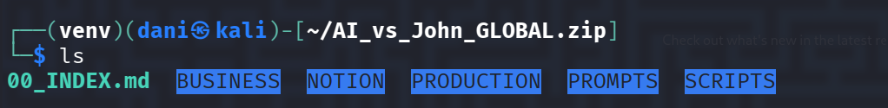

## Ready Files

- [NOTION_STRUCTURE.md](NOTION_STRUCTURE.md)
- [01_REVENUE_MODEL.md](01_REVENUE_MODEL.md)
- [00_INDEX.md](00_INDEX.md)
- [01_CHARACTER_BIBLE.md](01_CHARACTER_BIBLE.md)
- [02_TONE_GUIDE.md](02_TONE_GUIDE.md)
- [03_EPISODE_STRUCTURE.md](03_EPISODE_STRUCTURE.md)
- [LEONARDO_AI_VISUAL.txt](LEONARDO_AI_VISUAL.txt)
- [OLLAMA_AGENT.txt](OLLAMA_AGENT.txt)
- [BATCH_01_Episodes_1-20.md](BATCH_01_Episodes_1-20.md)

## Summary

**Series:** English (scripts, voiceover, captions)  
**Audience:** 18–40, global  
**Files:** English content + Hebrew headers/notes for your Notion workspace  
**Everything:** Scripts, prompts, structure, revenue model, agent

---

## What's Inside the ZIP (25 KB, 9 Files)

📁 **PRODUCTION/**
- Character Bible (English + Hebrew headers)
- Tone Guide (dialogue rules)
- Episode Structure (template)

📁 **SCRIPTS/**
- **20 complete episodes (EP1–20)** — ready for filming

📁 **PROMPTS/**
- Leonardo AI (visual generation)
- Ollama Agent (AI manager) — copy into Custom GPT

📁 **BUSINESS/**
- Revenue Model (3 revenue streams, projections, timeline)

📁 **NOTION/**
- **INDEX** — roadmap for the entire project

---

## Getting Started

1. **Extract the ZIP file**
2. **Copy the contents into Notion** (follow NOTION_STRUCTURE.md)
3. **Generate visuals** (Leonardo prompts are ready)
4. **Start publishing** — begin with EP1–5

### Ollama = The Project's Automated Manager

It will act as:

- **Script Generator** — generates 20 episodes with one click
- **Quality Controller** — checks that everything follows the rules
- **Prompt Manager** — prepares prompts for Leonardo
- **Analytics Tracker** — tracks performance
- **Token Counter** — manages the token budget and usage
- **Project Memory** — remembers everything, always

## Installation (5 Minutes)

**Linux / WSL:**

```bash
curl -fsSL https://ollama.com/install.sh | sh
```

**Windows:**

Download from https://ollama.com/download

## Download the Model (One Time Only)

```bash
# My recommendation:
ollama pull llama3.2
```

This downloads approximately 2 GB.  
It takes 5–10 minutes, depending on your internet speed.

**Alternatives:**
- `mistral` — sharper tone
- `nous-hermes2` — good for structured tasks

## Setting Up the Project

```text
~/AI_vs_John/
├── PRODUCTION/
│   ├── 01_CHARACTER_BIBLE.md
│   ├── 02_TONE_GUIDE.md
│   └── ...
├── BUSINESS/
│   └── 01_REVENUE_MODEL.md
```

```bash
mkdir -p ~/AI_vs_John
cd ~/AI_vs_John

unzip AI_vs_John_COMPLETE_*.zip
```

## Setup Verification

[Structure Verification](https://app.notion.com/p/30067f03358b80f59374da853e2e804b?pvs=21)

The expected output should look like this:



## Access

[Notion Page 1](https://app.notion.com/p/30a67f03358b80e5abfde21e5bb06b17?pvs=21)

[Notion Page 2](https://app.notion.com/p/30f67f03358b80e7b7e6c3a23d98ad07?pvs=21)

[**TikTok Project 1 – AI & John Dialogue Videos**](https://app.notion.com/p/1-AI-30f67f03358b81bcbfc3d92ffe165f6a?pvs=21)
